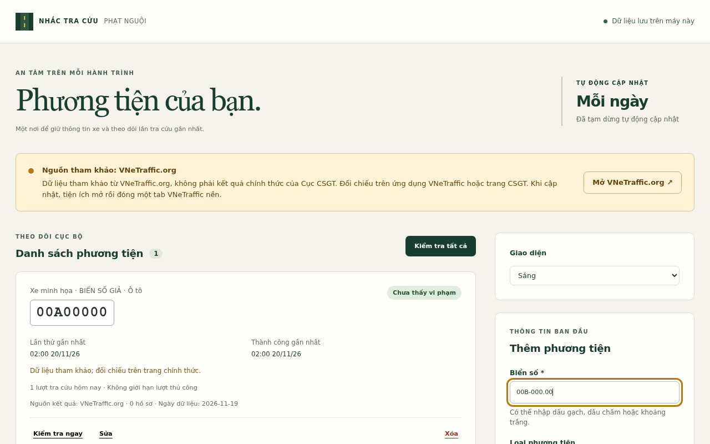
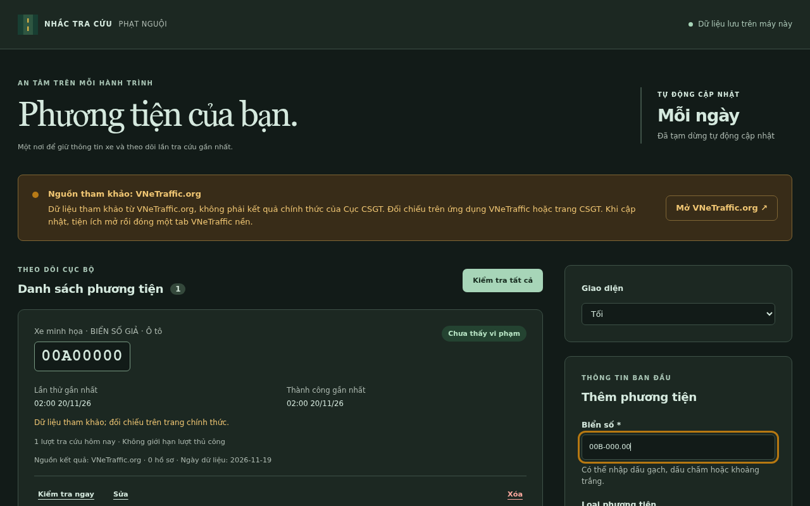
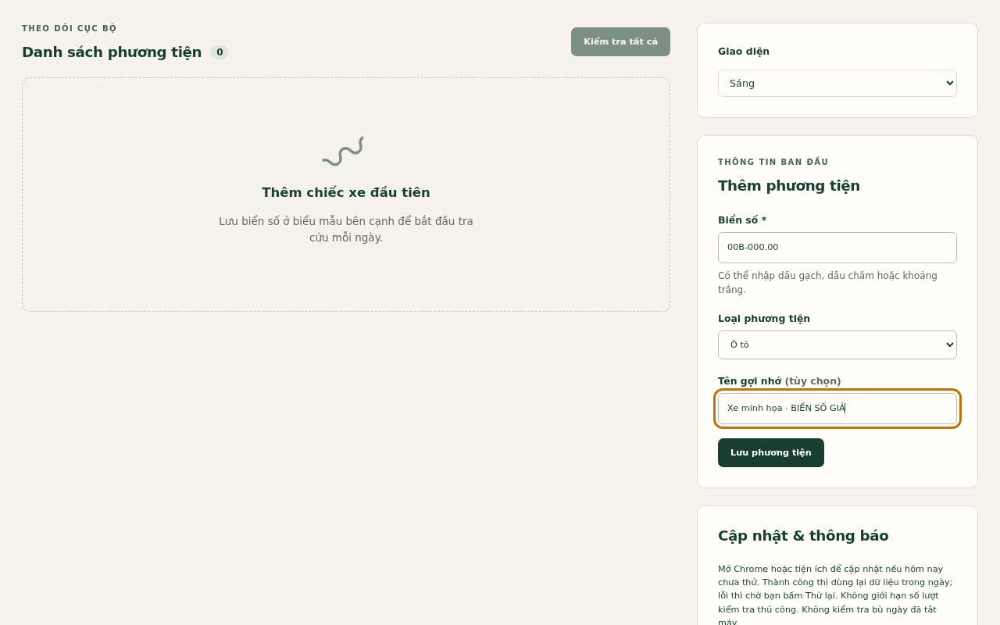
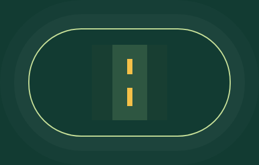

# Nhắc tra cứu phạt nguội — Chrome extension 0.2.3

## Trang ủng hộ

Trang `src/donate.html` được liên kết từ popup và trang quản lý. Chỉnh danh sách trong `src/donate-config.js` trước khi đóng gói để thêm nhiều phương thức. Ví dụ (thay toàn bộ thông tin bằng thông tin thật):

```js
export const donationMethods = [
  { label: 'NGÂN HÀNG', title: 'Chuyển khoản Việt Nam', details: 'Ngân hàng: ...\nSố tài khoản: ...\nChủ tài khoản: ...', qr: '../icons/donate-bank.png' },
  { label: 'KO-FI', title: 'Mời tôi một ly cà phê', url: 'https://ko-fi.com/ten-cua-ban' },
  { label: 'CRYPTO', title: 'USDT', description: 'Mạng: ...', details: 'Địa chỉ ví: ...', qr: '../icons/donate-crypto.png' },
];
```

Ảnh QR phải được đặt trong thư mục `icons/` của tiện ích; đường dẫn `qr` là tương đối từ `src/`. Chỉ dùng liên kết HTTPS cho `url`. Xóa trường `qr` nếu chưa có ảnh. Kiểm tra kỹ chủ tài khoản, địa chỉ ví và mạng trước khi phát hành; danh sách rỗng sẽ hiển thị thông báo chưa có phương thức ủng hộ. Sau khi chỉnh, tải lại tiện ích hoặc đóng gói phiên bản mới.

Extension Manifest V3, tiếng Việt, lưu dữ liệu trên máy, không cần build hay cài thư viện để chạy. Công cụ tạo ảnh store dùng Playwright (devDependency).

**Đã kiểm chứng tra cứu thật thành công từ extension Chrome:** 51K999999 (xe máy) trả not_found, 0 hồ sơ, dữ liệu đến 2026-09-25. Nguồn VNeTraffic.org chỉ mang tính tham khảo. Xem [báo cáo bản 0.2.1](docs/vnetraffic-0.2.1.md) và [bằng chứng Chrome](artifacts/chrome-report.json).

## Tải lại / cài đặt

1. Mở chrome://extensions và bật Developer mode.
2. Với bản đã cài, bấm Reload / Tải lại. Nếu Chrome yêu cầu, cho phép quyền truy cập https://vnetraffic.org/*.
3. Với bản mới, chọn Load unpacked và thư mục tracuuphatnguoi chứa manifest.json.
4. Đóng rồi mở lại popup/trang quản lý. Xe, kết quả và lịch sử cũ được giữ khi nâng schema 1 lên 2; lịch cũ được thay bằng kiểm tra nền mỗi ngày.
5. Chọn loại xe chính xác; mẫu kiểm thử: 51K999999, Xe máy.

## Cập nhật và lưu trữ

- Tự kiểm tra khi Chrome khởi động và khi mở popup/trang quản lý. Lịch nền bắt đầu sau khoảng một phút, rà soát mỗi 5 phút để cập nhật khi sang ngày mới ngay cả khi không mở tiện ích. Mỗi xe chỉ tự thử một lượt/ngày theo giờ máy; có kết quả thành công hôm nay thì dùng dữ liệu lưu. Chrome có thể trì hoãn alarm; máy ngủ hoặc Chrome tắt hoàn toàn thì không tra cứu, khi hoạt động lại chỉ kiểm tra ngày hiện tại.
- Mỗi ngày chỉ tự thử một lượt. Sau lỗi, mở lại cùng ngày chỉ hiển thị lỗi và dữ liệu cũ, chờ bạn bấm **Thử lại**. Ngày hôm sau có thể tự thử một lượt mới.
- Nút **Kiểm tra ngay / Kiểm tra tất cả / Thử lại** không giới hạn số lượt thủ công, kể cả sau khi đã cập nhật thành công; đã bỏ trần 3 lượt/ngày theo yêu cầu kiểm thử ở bản 0.2.2.
- Tự động cập nhật vẫn chỉ một lượt/ngày, lỗi không tự retry và không chạy bù ngày máy tắt. Chống yêu cầu trùng vẫn hoạt động.
- Lưu kết quả, lần thử, thành công gần nhất, số lượt, lịch sử và tối đa 20 lỗi gần nhất trong chrome.storage.local. Không dùng storage.sync.
- Chống trùng giữa startup, nhiều cửa sổ, popup và nút bấm. Đóng popup không hủy công việc của service worker; nếu worker bị ngắt, lần mở lại hiển thị lỗi gián đoạn thay vì tự retry.
- Khi lỗi, giữ nguyên kết quả cũ và thời điểm thành công. Nếu chưa có kết quả thì không suy diễn thành “Chưa thấy vi phạm”.
- Có **Chi tiết lỗi**, **Sao chép thông tin lỗi** và xuất JSON. Log chỉ chứa mã lỗi chuẩn hóa, thời gian, bước, HTTP status, thời gian xử lý và phiên bản; không chứa cookie, nonce hay thông tin xác thực.
- Có thể tạm dừng tự động cập nhật; nút kiểm tra chủ động vẫn hoạt động. Chỉ giữ thông báo khi kết quả vi phạm thay đổi, không gửi tổng hợp theo lịch.

## Nguồn và quyền

Khi cần cập nhật, tiện ích mở tạm https://vnetraffic.org/tra-cuu-phat-nguoi-vnetraffic/ trong tab nền, đọc JSON cấu hình VNE rồi POST JSON tới https://vnetraffic.org/wp-json/vne/v1/lookup ngay trong ngữ cảnh trang đó. Tab tạm được đóng khi hoàn tất; tiện ích không chiếm tab đang mở của bạn. Nếu bạn chuyển tab tạm sang trang khác, tiện ích giữ lại tab đó. Cấu hình chỉ được đọc như JSON, không eval mã website; nonce không được lưu và POST không gửi cookie hay dùng phiên đăng nhập. Chỉ xin host permission https://vnetraffic.org/*.

Ánh xạ: car → car, motorcycle → motorbike, electric → electricbike. Mỗi yêu cầu, kể cả đọc body, có timeout 25 giây; không tự retry hoặc tự làm mới nonce khi lỗi. Một lượt gồm tải trang thật và tối đa một POST. Việc chờ tab sẵn sàng cũng có giới hạn 25 giây. Không thêm quyền scripting/tabs; content script đóng gói chỉ chạy ở đúng đường dẫn tra cứu VNeTraffic.

Kiểm tra biển số và loại xe phản hồi, cấu trúc trạng thái, danh sách hồ sơ và ngày dữ liệu. Chỉ not_found hợp lệ với danh sách rỗng mới hiển thị “Chưa thấy vi phạm”. found phải có hồ sơ; ID hồ sơ được tạo ổn định bằng SHA-256. Hiển thị nguồn VNeTraffic.org, data_as_of và thời điểm kiểm tra.

Đây là dữ liệu tham khảo từ một website độc lập. Nút **Mở VNeTraffic.org** trên popup và trang quản lý mở https://vnetraffic.org/tra-cuu-phat-nguoi-vnetraffic/ để kiểm tra thủ công. Kết quả chính thức cần đối chiếu trong ứng dụng VNeTraffic hoặc cổng CSGT.

Quyền storage để lưu cục bộ, notifications cho báo thay đổi. Quyền alarms dùng để đánh thức service worker kiểm tra ngày mới, không cần mở popup. Lịch được khôi phục nếu bị mất khi khởi động lại; lịch tổng hợp cũ được xóa.

## Kiểm thử

Yêu cầu Node.js 22.16 trở lên. Unit tests không cần thư viện; chạy `npm ci` khi dùng công cụ store:

```sh
rtk npm run check
rtk npm test
rtk npm run test:coverage
rtk npm run test:chrome
```

Node tests dùng fetch/Chrome API giả lập ở ranh giới để kiểm tra nghiệp vụ, không chứng minh API thật. Coverage gồm domain, scheduler (ngày địa phương), controller, storage, source, errors, page-source và vne-bridge; không bao gồm UI/background/CDP.

Chrome harness dùng profile tạm riêng và extension unpacked thật. Kiểm tra mạng thật trước khi dùng fixture cục bộ có nhãn để kiểm tra riêng giao diện dữ liệu cũ. Báo cáo tách harnessStatus và liveLookup: PASS khi kiểm tra và tra cứu thật đều thành công; PARTIAL/exit 1 nếu giao diện đạt nhưng tra cứu thật chưa thành công. CHROME_PATH chọn binary khác; Chrome cần chạy trong môi trường cho phép browser và truy cập mạng. Không dùng cờ disable-crashpad-for-testing vì đã tái hiện crash network service trên Chrome 150.

Dữ liệu còn sau đóng Chrome/khởi động lại máy; gỡ tiện ích hoặc xác nhận xóa toàn bộ dữ liệu sẽ xóa kho. Xuất JSON trước khi xóa; chưa có chức năng nhập lại bản sao.

## Phát hành Chrome Web Store (T-017 / T-018)

```sh
npm ci
npm run store:assets
npm run build
npm test
npm run test:coverage
```

`store:assets` dùng Playwright tải extension unpacked thật trong Chrome, sinh ba
ảnh 1280×800 và promo tile 440×280 vào `store/` bằng một lệnh. Cần Chrome hỗ trợ
CDP Extensions.loadUnpacked (đã dùng binary `/usr/bin/google-chrome`); đặt
`CHROME_PATH` nếu khác. Môi trường container yêu cầu có thể dùng
`CHROME_NO_SANDBOX=1 npm run store:assets`. Profile tạm `.store-profile/` được xóa
sau chạy; không dùng đồng thời nhiều lượt tạo ảnh. HTTP(S) bị chặn, tự cập nhật
tạm dừng; chỉ biển số giả `00…` và dữ liệu minh họa được dùng, không gửi tới nguồn.






`npm run build` chạy kiểm tra tĩnh rồi tạo ZIP sạch bằng `zip` (cần cài lệnh này).
`npm run package` chỉ đóng gói: manifest ở gốc, src/, icons/ và LICENSE; không kèm
node_modules, cấu hình riêng, tests, ảnh store hoặc artifacts. File kết quả:
`dist/tra-cuu-phat-nguoi-0.2.3.zip` (không đưa vào Git). Không có bước biên dịch.

Nội dung VI/EN, lý do từng quyền và checklist gửi tay ở [store/listing.md](store/listing.md).
[Chính sách riêng tư VI/EN](store/PRIVACY.md) cần được nhà phát hành đăng tại URL
HTTPS công khai và điền vào dashboard cùng thông tin hỗ trợ thật trước khi gửi.
Giấy phép mã nguồn: [MIT](LICENSE). Người dùng tự gửi; script không đăng nhập hay
nộp lên Chrome Web Store. Bộ ảnh minh họa không chứng minh API thật đang hoạt động.
